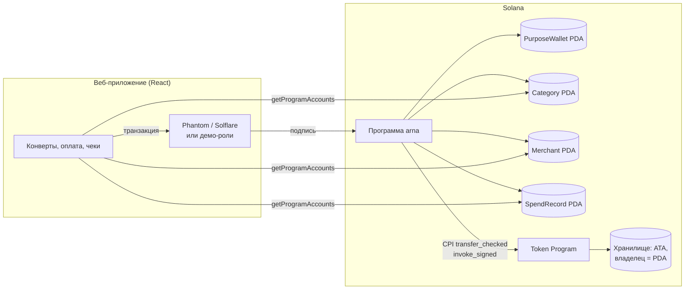
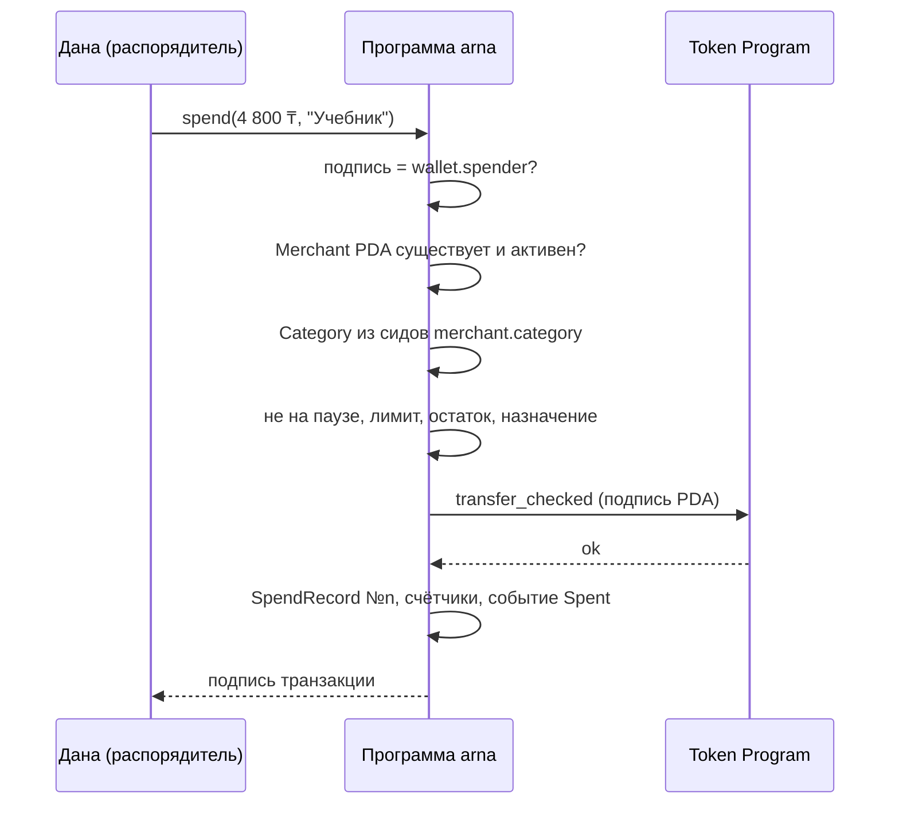

# Архитектура Arna

## Компоненты

## Поток оплаты

## Модель данных

| Аккаунт | Поля |
|---|---|
| PurposeWallet | owner, spender, mint, vault, id, name, total_deposited, total_spent, total_refunded, spend_count, category_count, merchant_count, paused, created_at, bump |
| Category | wallet, index, name, limit, period, period_start, spent_in_period, total_spent, bump |
| Merchant | wallet, recipient, category, name, active, total_received, bump |
| SpendRecord | wallet, index, spender, merchant, recipient, category, amount, memo, timestamp, bump |

`owner` идёт сразу за дискриминатором (смещение 8), `spender` — по смещению 40. Поэтому приложение находит «мои кошельки» одним `getProgramAccounts` с `memcmp`. Чеки, конверты и получатели фильтруются по полю `wallet` на смещении 8.

## Периодический лимит

`period = 0` означает лимит на всё время. Если `period > 0`, при каждой трате вызывается `roll_period(now)`: когда прошёл хотя бы один период, `spent_in_period` обнуляется, а начало периода сдвигается на границу сетки (`now − elapsed % period`). Так лимит «в неделю» не уплывает, а `total_spent` хранит общую сумму. Логика покрыта unit-тестами в `state.rs`.

## Ошибки

| Код | Когда |
|---|---|
| NotOwner | правила меняет не владелец |
| NotSpender | тратит не распорядитель |
| WalletPaused | кошелёк на паузе |
| MerchantInactive | получатель отключён |
| LimitExceeded | превышен лимит конверта |
| InsufficientFunds | в хранилище меньше суммы |
| MemoRequired / MemoTooLong | нет назначения или оно длиннее 96 байт |
| NameEmpty / NameTooLong | пустое или длинное название |
| InvalidPeriod | период от 1 до 59 секунд |
| TooManyCategories | больше 16 конвертов |
| AccountNotInitialized (Anchor) | получателя нет в списке |
| ConstraintSeeds (Anchor) | попытка списать с чужого конверта |
